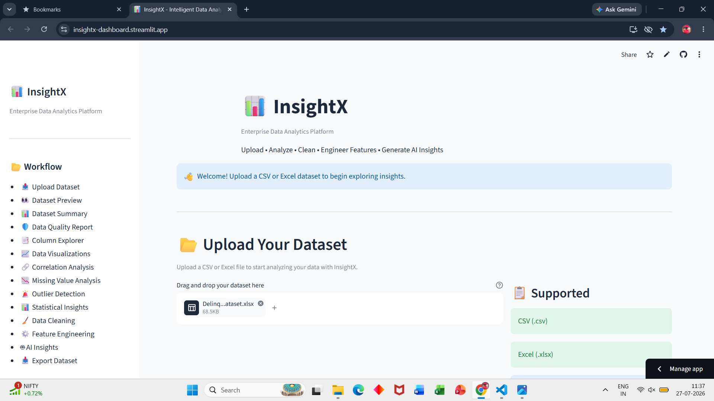
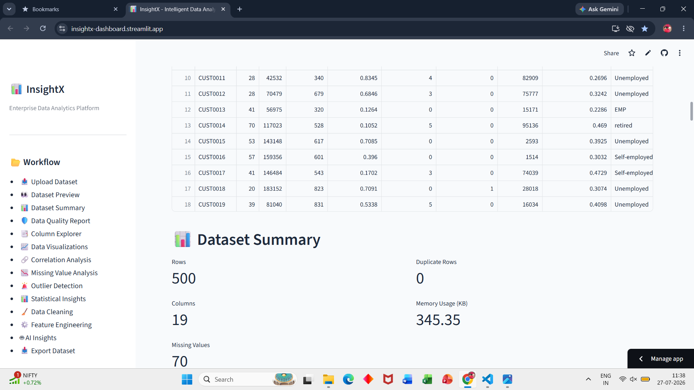
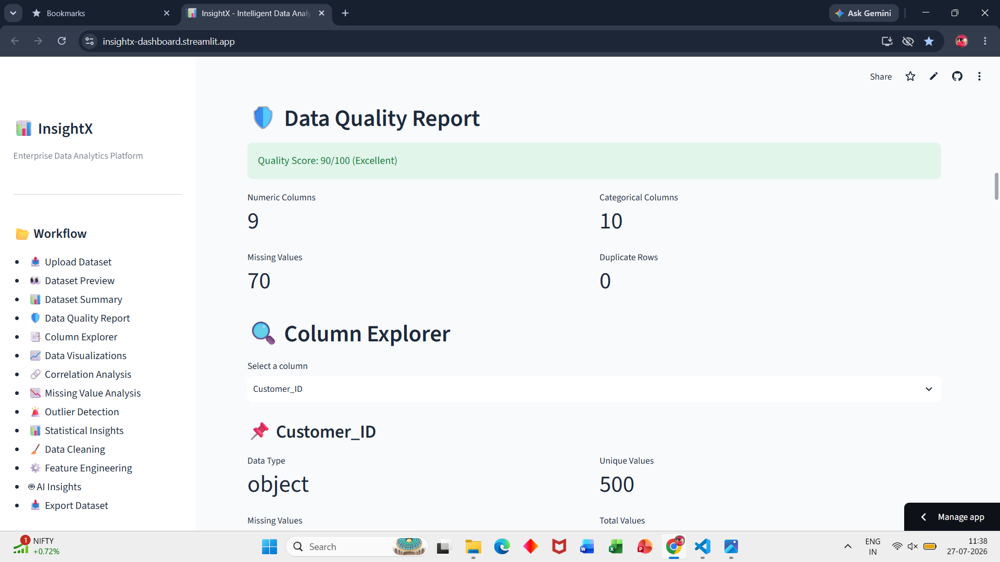
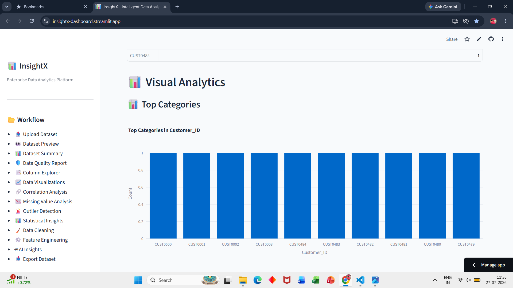
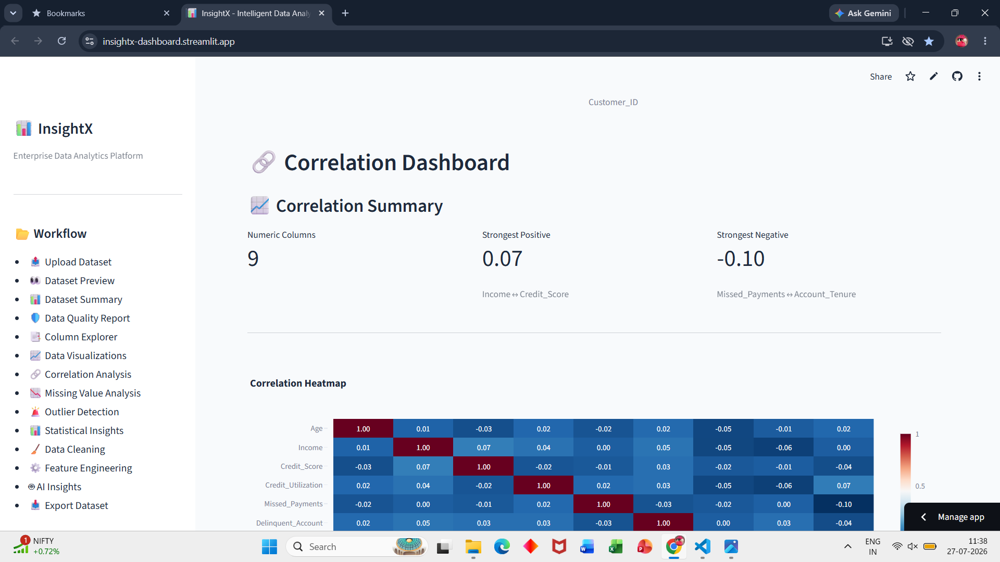
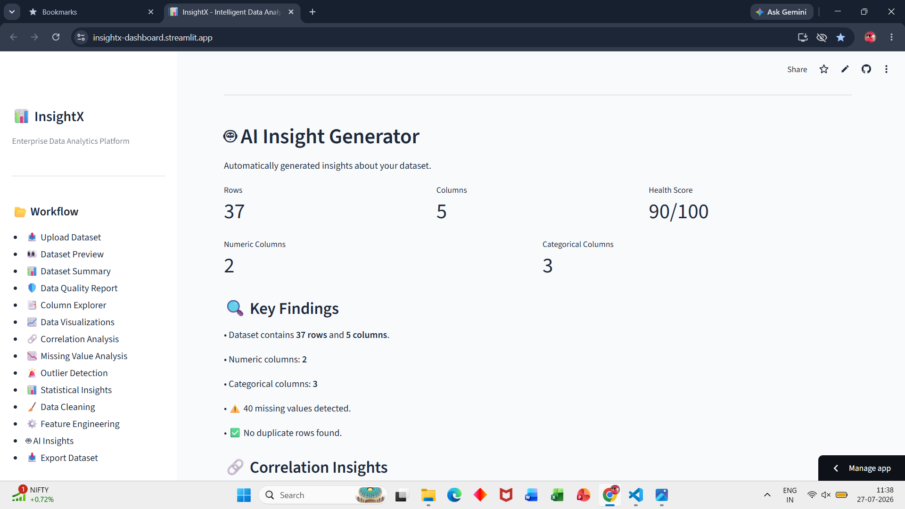
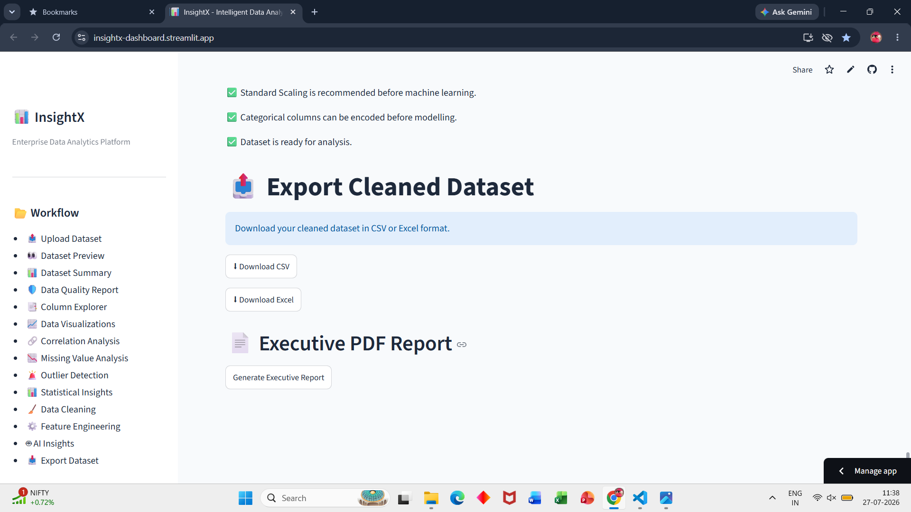
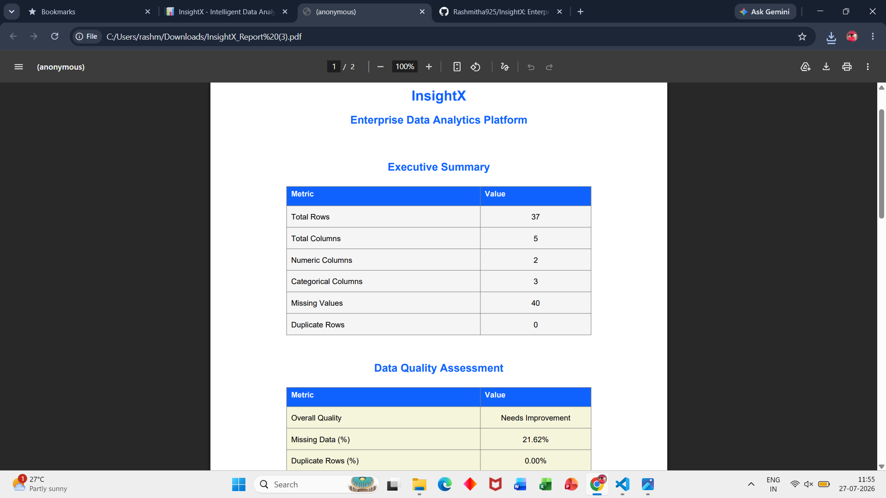

# 📊 InsightX – Enterprise Data Analytics Platform

<p align="center">


</p>

<p align="center">

### Upload • Analyze • Clean • Engineer Features • Generate AI Insights

</p>

---

## 🚀 Live Demo

🌐 **Application:** https://insightx-dashboard.streamlit.app

📂 **GitHub Repository:** https://github.com/Rashmitha925/InsightX

---

# 📖 Project Overview

InsightX is an end-to-end Enterprise Data Analytics Platform developed using **Python** and **Streamlit**.

The application enables users to upload CSV or Excel datasets and perform a complete analytics workflow, including:

- Data Profiling
- Data Quality Assessment
- Exploratory Data Analysis (EDA)
- Interactive Visualizations
- Correlation Analysis
- Missing Value Detection
- Outlier Detection
- Data Cleaning
- Feature Engineering
- AI-Based Dataset Insights
- Export of Cleaned Data
- Executive PDF Report Generation

The objective of InsightX is to simplify data exploration by combining data preprocessing, visualization, statistical analysis, and automated reporting into a single interactive web application.

---

# ✨ Key Features

## 📂 Data Upload

- Upload CSV datasets
- Upload Excel datasets
- Automatic dataset preview

---

## 📊 Data Analysis

- Dataset Summary
- Data Quality Report
- Column Explorer
- Statistical Insights
- Missing Value Analysis
- Outlier Detection

---

## 📈 Interactive Visualizations

- Bar Charts
- Histograms
- Scatter Plots
- Correlation Heatmaps
- Distribution Analysis

---

## 🧠 AI Insights

Automatically generates:

- Dataset Health Score
- Key Findings
- Correlation Insights
- Data Cleaning Recommendations
- Machine Learning Readiness Suggestions

---

## 🛠 Data Engineering

- Missing Value Imputation
- Duplicate Detection
- Feature Engineering
- Data Cleaning Pipeline

---

## 📤 Export Options

- CSV Export
- Excel Export
- Executive PDF Report

---

# 🛠 Technology Stack

| Category | Technologies |
|-----------|--------------|
| Programming | Python 3.10 |
| Framework | Streamlit |
| Data Processing | Pandas, NumPy |
| Visualization | Plotly |
| Machine Learning | Scikit-learn |
| Statistical Analysis | SciPy |
| Excel Support | OpenPyXL |
| PDF Generation | ReportLab |
| Version Control | Git & GitHub |
| Deployment | Streamlit Community Cloud |

---
# 📸 Application Screenshots

## 🏠 Home Page

Upload CSV or Excel datasets and start analyzing data instantly.



---

## 📊 Dataset Summary

Get an instant overview of your dataset including rows, columns, memory usage, duplicate records, and missing values.



---

## 🛡 Data Quality Report

Automatically evaluate dataset quality with health scores and identify potential issues before analysis.



---

## 📈 Interactive Visualizations

Generate interactive charts to better understand patterns, distributions, and trends.



---

## 🔗 Correlation Analysis

Explore relationships between numerical variables using an interactive correlation heatmap.



---

## 🤖 AI Insight Generator

Automatically generate key findings, health scores, recommendations, and machine learning readiness insights.



---

## 📤 Export & Reporting

Download cleaned datasets in CSV/Excel format and generate executive PDF reports.



---

## 📄 Executive PDF Report

Generate a professional PDF report summarizing the dataset and insights.



---

# 🏗 System Architecture

```

```text
                     User
                       │
                       ▼
              Upload CSV / Excel
                       │
                       ▼
             Dataset Validation
                       │
                       ▼
            Data Profiling Engine
                       │
        ┌──────────────┼──────────────┐
        ▼              ▼              ▼
 Data Quality      Data Cleaning   Feature Engineering
        │              │              │
        └──────────────┼──────────────┘
                       ▼
             Analytics Processing
                       │
        ┌──────────────┼──────────────┐
        ▼              ▼              ▼
 Visualizations  Statistical Analysis AI Insights
                       │
                       ▼
            Export & Report Generation
                       │
        ┌──────────────┼──────────────┐
        ▼              ▼              ▼
        CSV          Excel           PDF
```
# 📂 Project Structure

```text
InsightX/
│
├── assets/
├── src/
│   ├── components/
│   ├── reports/
│   ├── services/
│   └── app.py
│
├── requirements.txt
├── README.md
└── .gitignore
```

The project follows a modular architecture where UI components, services, and reporting modules are separated for better maintainability and scalability.

---
# ⚙️ Installation

Follow these steps to run InsightX on your local machine.

## 1️⃣ Clone the Repository

```bash
git clone https://github.com/Rashmitha925/InsightX.git
```

---

## 2️⃣ Navigate to the Project

```bash
cd InsightX
```

---

## 3️⃣ Create a Virtual Environment

### Windows

```bash
python -m venv .venv
```

Activate the virtual environment:

```bash
.venv\Scripts\activate
```

---

## 4️⃣ Install Dependencies

```bash
pip install -r requirements.txt
```

---

## 5️⃣ Run the Application

```bash
streamlit run src/app.py
```

The application will launch in your browser.

---

# 🚀 Live Deployment

The application is deployed on **Streamlit Community Cloud**.

### Live Demo

👉 https://insightx-dashboard.streamlit.app

---

# 🔮 Future Enhancements

Future improvements planned for InsightX include:

- User authentication and role-based access
- Database integration (PostgreSQL/MySQL)
- Predictive Machine Learning models
- Automated anomaly detection
- Natural Language Query interface
- Cloud storage integration
- Dashboard customization
- API integration for real-time datasets
- Advanced business KPI dashboards
- AI-powered conversational analytics

---

# 🎯 Skills Demonstrated

This project demonstrates practical experience in:

- Python Programming
- Data Analysis
- Exploratory Data Analysis (EDA)
- Data Cleaning
- Feature Engineering
- Statistical Analysis
- Data Visualization
- Business Intelligence
- Streamlit Application Development
- Report Generation
- Git & GitHub
- Deployment using Streamlit Community Cloud

---

# 👩‍💻 Author

**Rashmitha M**

Information Science & Engineering Student

Passionate about:

- Data Analytics
- Machine Learning
- Artificial Intelligence
- Business Intelligence

GitHub:
https://github.com/Rashmitha925

---

# ⭐ If you found this project useful

Consider giving this repository a ⭐ on GitHub.

It motivates future improvements and helps others discover the project.

---

# 📜 License

This project is licensed under the MIT License.